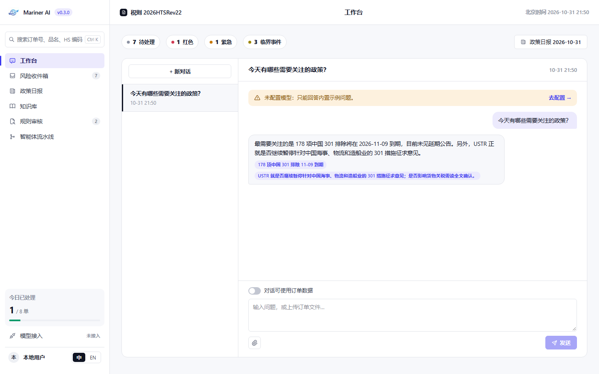

# Mariner AI

本地运行的关税影响与政策审核工作台。当前版本 **v0.3.0**，源码位于 [astra-dev-spec](astra-dev-spec/)。

- [安装、启动与测试](astra-dev-spec/README.md)
- [版本说明](astra-dev-spec/docs/RELEASE_NOTES.md)
- [v0.3 验收记录与截图](astra-dev-spec/docs/ACCEPTANCE_V03.md)
- [v0.3 任务状态](astra-dev-spec/docs/TASKS_V03.md)
- [待确认事项](astra-dev-spec/docs/QUESTIONS.md)

七个主页面采用统一的顶栏、侧栏和列表 / 详情布局。Windows 验收：22 项 Playwright、44 项 pytest、lint、TypeScript 和生产构建通过。

本地启动后访问 http://127.0.0.1:3000/ 。此地址仅对运行应用的本机有效。

源码仓库公开可见，采用 [MIT 许可证](LICENSE)。
